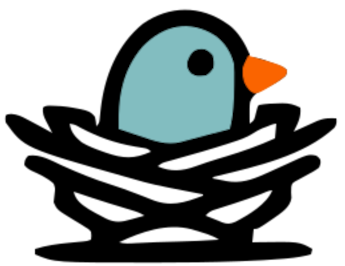
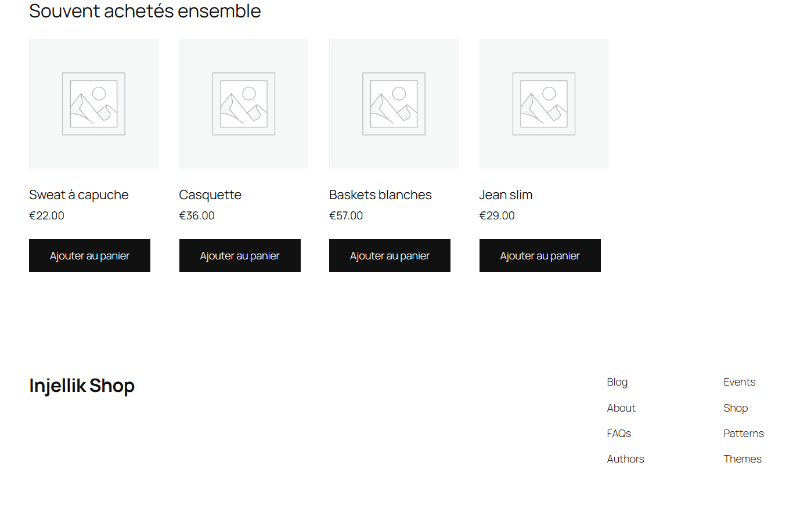
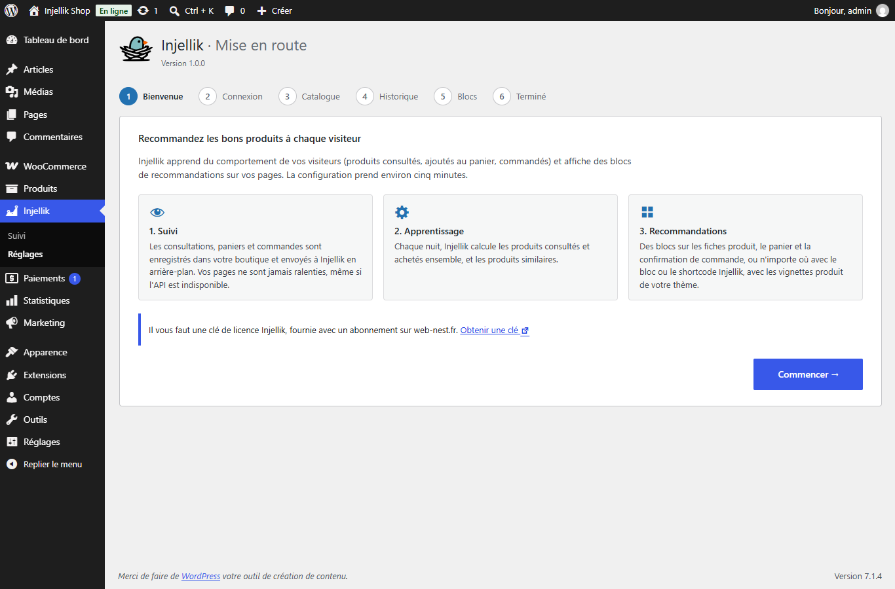
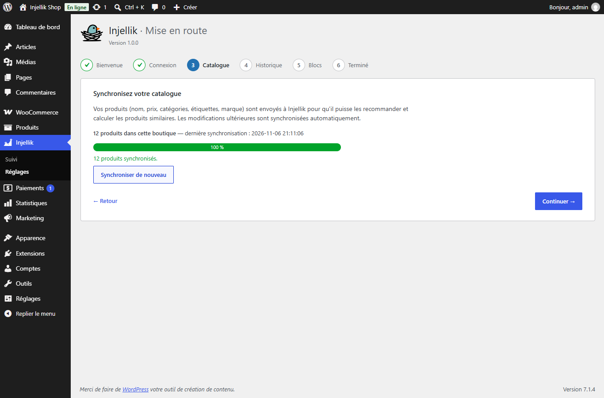
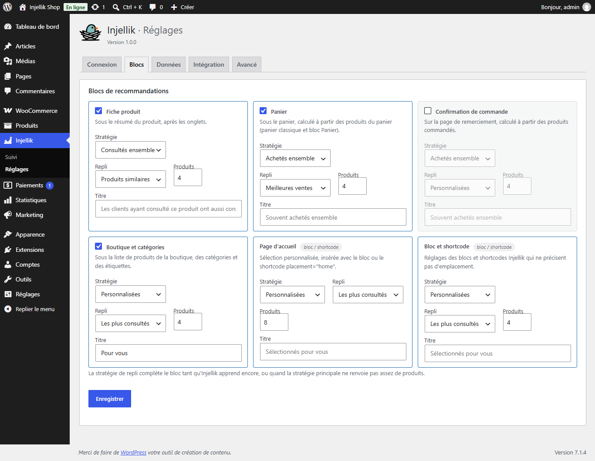
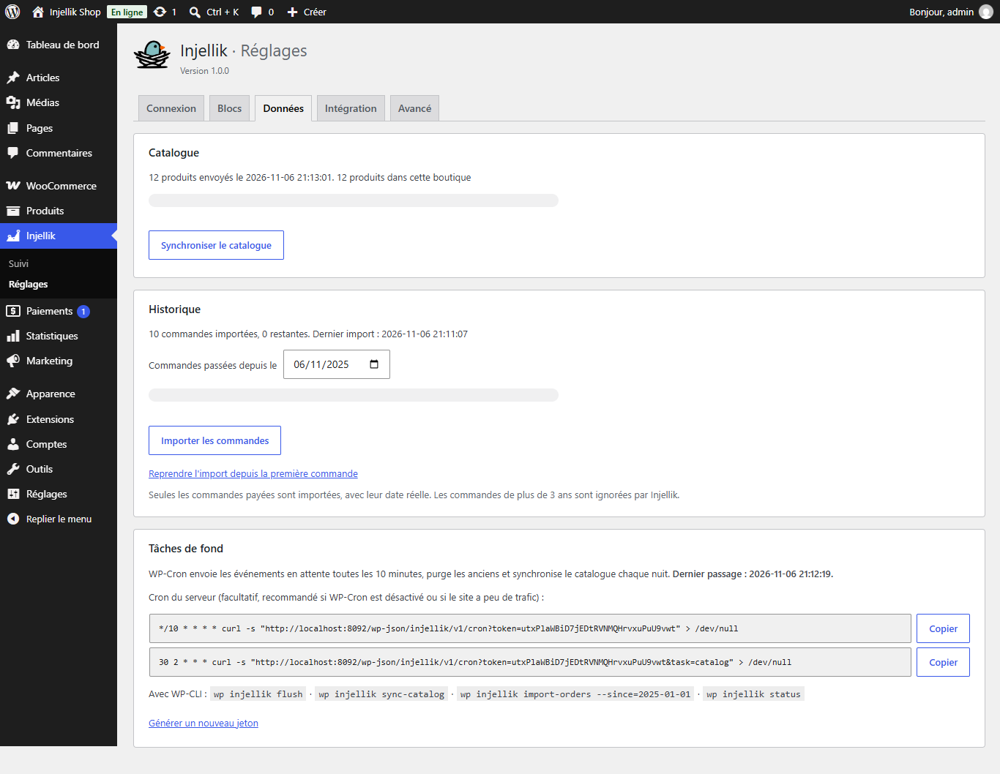
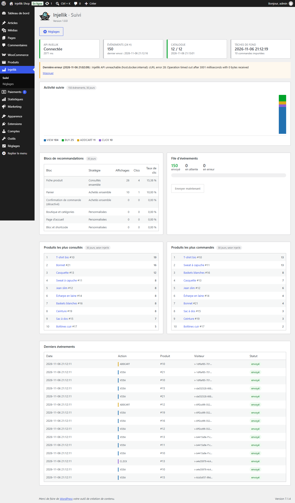

<h1 align="center">
  <br>
  Injellik Recommendations pour WooCommerce
</h1>

<p align="center">
  Recommandations de produits personnalisées, calculées à partir du comportement réel de vos visiteurs.
</p>

<p align="center">
  <a href="https://github.com/guillaumemonet/injellik-woocommerce/actions/workflows/ci.yml"></a>
  <a href="https://github.com/guillaumemonet/injellik-woocommerce/releases/latest"></a>
  
  
  
  <a href="LICENSE"></a>
</p>

<p align="center">
  
</p>

Cette extension connecte votre boutique WooCommerce à l'API **[Injellik](https://www.web-nest.fr/injellik)**. Elle suit ce que font vos visiteurs (produits consultés, ajoutés au panier, commandés, notés), l'envoie à Injellik qui en déduit chaque nuit les produits **consultés ensemble**, **achetés ensemble** et **similaires**, puis affiche des blocs de recommandations sur vos pages, avec les vignettes produit de votre thème.

C'est le pendant du [module PrestaShop](https://github.com/guillaumemonet/injellik-prestashop) : mêmes stratégies, même API, même clé de licence.

## Sommaire

- [Fonctionnalités](#fonctionnalités)
- [Prérequis](#prérequis)
- [Installation](#installation)
- [Démarrage rapide](#démarrage-rapide)
- [Afficher des recommandations](#afficher-des-recommandations)
- [Données collectées](#données-collectées)
- [Tâches de fond](#tâches-de-fond)
- [Page de suivi](#page-de-suivi)
- [Réglages avancés](#réglages-avancés)
- [Pour les développeurs](#pour-les-développeurs)
- [Dépannage](#dépannage)
- [Développement](#développement)

## Fonctionnalités

- **Assistant d'installation** en six étapes : connexion, synchronisation du catalogue, import de l'historique de commandes, choix des blocs.
- **Emplacements prêts à l'emploi** : fiche produit, panier (classique et bloc Panier), page de remerciement, boutique et catégories, plus la page d'accueil et n'importe quelle page avec le bloc ou le shortcode.
- **Sept stratégies** : consultés ensemble, achetés ensemble, produits similaires, personnalisées, clients similaires, les plus consultés, meilleures ventes. Chaque bloc a une stratégie de repli tant qu'Injellik apprend encore.
- **Intégration libre** : bloc Gutenberg « Recommandations Injellik », shortcode `[injellik_recommendations]`, fonction PHP, template surchargeable par le thème.
- **Compatible thèmes blocs et thèmes classiques** (testé avec Twenty Twenty-Five), HPOS et blocs Panier / Commande.
- **Compatible avec les caches de page** (WP Rocket, LiteSpeed, Varnish…) : les blocs se chargent après la page, et les consultations sont signalées par le navigateur. La page elle-même ne pose aucun cookie.
- **Aucun impact sur les performances** : les événements passent par une file locale et partent après la réponse, par lots (un seul appel à l'API pour 500 événements).
- **Résilient** : une API lente ou indisponible, ou un abonnement suspendu, ne ralentit ni ne casse jamais la boutique, y compris la validation des commandes. Les événements sont renvoyés automatiquement.
- **Page de suivi** : état de l'API, activité, taux de clic par bloc, file d'événements, produits phares.
- **Respect de la vie privée** : identifiants pseudonymes, aucune donnée personnelle ne quitte la boutique ; texte pour la politique de confidentialité et effacement des données RGPD (Outils > Effacer les données personnelles).
- **WP-CLI** : `wp injellik status | flush | sync-catalog | import-orders`.
- **Multisite** (une clé de licence par site) ; interface en français et en anglais.

## Prérequis

| | Version |
|---|---|
| WordPress | 6.5 ou plus récent (testé sur 7.1) |
| WooCommerce | 8.0 ou plus récent (testé sur 11.2) |
| PHP | 7.4 à 8.4 |
| Licence | une clé de licence Injellik, obtenue avec un abonnement sur [web-nest.fr](https://web-nest.fr/#tarifs) |

## Installation

1. Téléchargez **`injellik-recommendations-x.y.z.zip`** depuis la [dernière release](https://github.com/guillaumemonet/injellik-woocommerce/releases/latest).
   > N'utilisez pas « Download ZIP » de GitHub : cette archive contient tout le dépôt, et non la seule extension.
2. Dans l'administration, ouvrez **Extensions > Ajouter une extension > Téléverser une extension** et déposez le zip.
3. Activez l'extension, puis ouvrez le menu **Injellik** : l'assistant démarre.

En ligne de commande :

```bash
wp plugin install injellik-recommendations-x.y.z.zip --activate
```

## Démarrage rapide

L'assistant vous guide en six étapes. L'extension ajoute le menu **Injellik**, avec les pages **Suivi** et **Réglages**.

<p align="center"></p>

| Étape | Ce qui se passe |
|---|---|
| **Connexion** | La clé de licence de la boutique (`ijk_lic_…`), affichée dans votre compte web-nest.fr ([Mon compte > Boutiques](https://web-nest.fr/mon-compte/boutiques/)). Le bouton « Tester la connexion » vérifie que l'API répond et accepte la clé. |
| **Catalogue** | Les produits sont envoyés par lots de 100, avec une barre de progression. |
| **Historique** | Import facultatif des commandes payées depuis une date donnée, avec leur date réelle. Les recommandations « achetés ensemble » sont ainsi disponibles dès le prochain entraînement, sans attendre des semaines de suivi. Les commandes importées ne sont pas décomptées de l'abonnement. |
| **Blocs** | Choix des emplacements, des stratégies, du nombre de produits et des titres. |

> **Compte créé avant les abonnements ?** Le lien « Utiliser un identifiant API », sous le formulaire, ouvre l'ancienne connexion (URL de l'API, identifiant et mot de passe).

<p align="center"></p>

> **Quand les recommandations apparaissent-elles ?** Le suivi commence immédiatement. Injellik entraîne ses modèles chaque nuit. D'ici là, les blocs utilisent leur stratégie de repli (meilleures ventes, produits similaires…). Ils ne sont donc jamais vides si la boutique a déjà des ventes.

## Afficher des recommandations

### Emplacements intégrés

| Emplacement | Crochet WooCommerce | Produits sources | Par défaut |
|---|---|---|---|
| Fiche produit | `woocommerce_after_single_product_summary` | produit affiché | ✅ consultés ensemble → similaires |
| Panier | `woocommerce_after_cart`, et après le bloc Panier | produits du panier | ✅ achetés ensemble → meilleures ventes |
| Confirmation de commande | `woocommerce_thankyou` | produits commandés | ✅ achetés ensemble → personnalisées |
| Boutique et catégories | `woocommerce_after_shop_loop` | historique du visiteur | ❌ personnalisées → les plus consultés |
| Page d'accueil | bloc ou shortcode `placement="home"` | historique du visiteur | personnalisées → les plus consultés |
| Bloc et shortcode | bloc ou shortcode sans emplacement | produit affiché, panier ou commande | personnalisées → les plus consultés |

Sur un thème blocs, WooCommerce appelle ces crochets autour des blocs de ses templates : les emplacements fonctionnent sans adaptation.

<p align="center"></p>

### Stratégies

| Code | Nom | Principe | Endpoint de l'API |
|---|---|---|---|
| `viewed` | Consultés ensemble | produits vus dans les mêmes visites | `GET /api/recommendations/viewed/{sku}` |
| `bought` | Achetés ensemble | produits commandés ensemble | `GET /api/recommendations/bought/{sku}` |
| `similar` | Produits similaires | catégories, étiquettes, marque et prix proches | `GET /api/related/{sku}` |
| `personalized` | Personnalisées | d'après l'activité récente du visiteur | `GET /api/recommendations/user/{uuid}` |
| `predictive` | Clients similaires | ce qu'ont acheté les clients aux achats proches | `POST /api/recommendations/predictive` |
| `most_viewed` | Les plus consultés | 30 derniers jours | `GET /api/community-rankings/most-viewed` |
| `most_bought` | Meilleures ventes | 30 derniers jours | `GET /api/community-rankings/most-bought` |

L'extension complète la liste avec la stratégie de repli si la première ne renvoie pas assez de produits. Elle retire :

- les produits sources ;
- les produits non publiés, protégés par mot de passe ou masqués du catalogue ;
- les produits en rupture de stock (option ; les produits en réapprovisionnement restent).

### Bloc et shortcode

Dans l'éditeur de blocs ou l'éditeur de site, insérez le bloc **Recommandations Injellik** (catégorie WooCommerce) et réglez-le dans la barre latérale. Le shortcode accepte les mêmes paramètres :

```text
[injellik_recommendations]                                    réglages « Bloc et shortcode »
[injellik_recommendations placement="home"]                   mêmes réglages qu'un emplacement
[injellik_recommendations strategy="bought" fallback="most_bought" limit="4" title="Complétez le look"]
[injellik_recommendations strategy="similar" product_id="12,34,56"]
```

| Paramètre | Valeurs | Défaut |
|---|---|---|
| `placement` | `product`, `cart`, `order_confirmation`, `category`, `home`, `custom` | `custom` |
| `strategy` | un code de stratégie | celui de l'emplacement |
| `fallback` | un code de stratégie, ou `none` | celui de l'emplacement |
| `limit` | 1 à 24 | celui de l'emplacement |
| `title` | texte | titre de l'emplacement |
| `product_id` | un id ou plusieurs ids séparés par des virgules | produit affiché, sinon produits de la commande ou du panier |

Un bloc qui précise `placement` s'affiche même si l'affichage automatique de cet emplacement est désactivé.

### Dans un thème

```php
<?php if ( function_exists( 'injellik_recommendations' ) ) {
	injellik_recommendations( array( 'placement' => 'home' ) );
} ?>

<?php do_action( 'injellik_recommendations', array( 'strategy' => 'most_bought', 'limit' => 8 ) ); ?>
```

### Personnaliser le rendu

Le bloc reprend la boucle produit de WooCommerce (`content-product.php`), donc les vignettes de votre thème. Pour modifier son HTML, copiez le template dans votre thème :

```
wp-content/plugins/injellik-recommendations/templates/recommendations.php
  → wp-content/themes/<votre-thème>/injellik-recommendations/recommendations.php
```

Gardez l'attribut `data-injellik-placement` sur l'élément racine : c'est lui qui permet de mesurer les clics (l'id du produit est lu dans la classe `post-<id>` des vignettes).

Les blocs sont chargés **en asynchrone**. La page contient un emplacement signé, que `assets/js/front.js` remplace lorsqu'il approche de la zone visible. Après chaque insertion, un événement est émis :

```js
document.addEventListener('injellik:loaded', (event) => {
  const { element, placement } = event.detail; // initialiser un carrousel, etc.
});
// ou, avec jQuery, comme les autres événements de WooCommerce :
jQuery(document.body).on('injellik_loaded', (event, element) => { /* … */ });
```

## Données collectées

| Action | Déclencheur |
|---|---|
| `VIEW` | affichage d'une fiche produit (signalé par le navigateur) |
| `ADDCART` | ajout d'un produit au panier (y compris depuis les blocs et l'API Store) |
| `BUY` | commande passée en « En cours », « Terminée » ou « En attente », une seule fois par commande (un événement par produit) |
| `RATED` | avis produit publié avec une note (à la publication ou à l'approbation) |
| `CLICK` | clic sur un produit recommandé |

Chaque événement contient le type d'action, l'id produit (le SKU côté Injellik ; les variations sont rattachées à leur produit parent) et deux identifiants pseudonymes :

- **`user_uuid`** :
  - pour un client connecté, une empreinte de son id (`c-…`), calculée avec une clé secrète du site et non réversible ;
  - pour une commande d'invité sans visite connue, une empreinte de son e-mail (`g-…`) ;
  - sinon, un identifiant aléatoire conservé dans le cookie `injellik_vid` (`v-…`).
- **`user_session_uuid`** : identifiant de la visite (cookie de session `injellik_sid`), renouvelé après 30 minutes d'inactivité et après chaque commande.

La visite et le visiteur sont mémorisés sur la commande au moment du paiement : une commande confirmée plus tard par une notification de paiement reste rattachée à la bonne visite. Une commande créée hors de toute visite (administration) a sa propre session, `order-<id>`.

Les sessions servent de base à la facturation de l'abonnement : aucune n'est créée pour les robots (quand l'option « Ignorer les robots » est active).

**Ne sont jamais envoyés** : nom, e-mail, adresse, IP ou contenu des commandes (montants, adresses).

Pour le catalogue, l'extension envoie pour chaque produit :

- l'id, le nom, la description courte, le prix TTC et le GTIN/EAN (WooCommerce 9.2+) ;
- un champ `enabled`, à faux si le produit n'est pas publié ou est masqué du catalogue ;
- un `profile` (catégories, étiquettes, marque, prix) qui alimente le calcul des produits similaires. Le filtre `injellik_item` permet d'y ajouter des attributs.

Les produits créés, modifiés, mis à la corbeille ou supprimés sont synchronisés automatiquement, en un seul appel par requête.

**File locale.** Les crochets n'appellent jamais l'API : ils écrivent une ligne dans la table `wp_injellik_events`. Les événements partent ensuite :

- **à la fin de la requête** (par défaut) : avec PHP-FPM, après l'envoi de la page au visiteur ;
- **ou par la tâche de fond**.

En cas d'erreur réseau ou serveur, un événement est retenté jusqu'à 5 fois. Les événements envoyés sont purgés après 30 jours.

## Tâches de fond

WP-Cron envoie les événements en attente toutes les 10 minutes, purge les anciens, et synchronise tout le catalogue chaque nuit à 2 h 30.

Si WP-Cron est désactivé (`DISABLE_WP_CRON`) ou si le site a peu de trafic, planifiez les URL affichées dans **Réglages > Données** avec le cron du serveur :

```cron
*/10 * * * * curl -s "https://votre-boutique.fr/wp-json/injellik/v1/cron?token=XXXX" > /dev/null
30 2 * * *   curl -s "https://votre-boutique.fr/wp-json/injellik/v1/cron?token=XXXX&task=catalog" > /dev/null
```

La réponse est un JSON, par exemple `{"events":{"sent":12,"failed":0,"pending":0},"purged":3}`. Si l'API refuse la boutique, elle contient aussi `"api":"suspended"` ou `"api":"invalid_key"`.

Avec WP-CLI :

```bash
wp injellik status                              # connexion, file, dernières synchronisations
wp injellik flush [--retry-errors]              # envoi des événements en attente
wp injellik sync-catalog                        # synchronisation complète du catalogue
wp injellik import-orders --since=2025-01-01    # import de l'historique (reprend là où il s'était arrêté)
```

<p align="center"></p>

## Page de suivi

<p align="center"></p>

- **Santé** : connexion et latence de l'API, événements des dernières 24 h, état du catalogue, dernier passage des tâches de fond, dernière erreur.
- **Activité suivie** : événements par jour et par type sur 30 jours.
- **Blocs de recommandations** : affichages, clics et taux de clic par emplacement.
- **File d'événements** : envoyés, en attente, en erreur, avec deux boutons (envoyer maintenant, renvoyer les erreurs).
- **Classements** : produits les plus consultés et les plus commandés selon Injellik.
- **Derniers événements**, avec leur statut.

<sub>Captures réalisées sur une boutique de démonstration avec des données simulées.</sub>

## Réglages avancés

Ces réglages se trouvent dans **Réglages > Avancé**.

| Réglage | Défaut | Détail |
|---|---|---|
| URL de l'API | `https://injellik.web-nest.fr` | À ne modifier que sur demande de Web-Nest. |
| Affichage des blocs | Asynchrone | « Dans la page » appelle l'API pendant la génération de la page : les blocs sont visibles sans JavaScript, mais la page est plus lente et n'est pas personnalisée derrière un cache de page. |
| Envoi des événements | Fin de requête | Choisissez « Tâche de fond uniquement » si PHP tourne en module Apache. |
| Délai d'attente de l'API | 3 s | Pour les appels faits à l'affichage d'un bloc. L'administration et les tâches de fond attendent jusqu'à 20 s. |
| Cache des recommandations | 900 s | Cache d'objets persistant (Redis, Memcached) s'il y en a un, transients sinon. Les recommandations personnalisées sont gardées 60 s au maximum, et seulement avec un cache d'objets persistant. |
| Colonnes | 4 | Produits par ligne dans les blocs. |
| Masquer les produits en rupture | oui | Les produits en réapprovisionnement restent. |
| Ignorer les robots | oui | Filtre sur le user-agent. |
| Synchronisation automatique | oui | Envoie un produit à son enregistrement. |
| Catalogue chaque nuit | oui | Synchronisation complète par WP-Cron. |

**Multisite** : chaque site a ses propres réglages, tables et clé de licence. L'activation réseau installe l'extension sur tous les sites.

## Pour les développeurs

| Filtre / action | Rôle |
|---|---|
| `injellik_item` | Modifier l'item envoyé pour un produit (`$item`, `$product`) : ajouter des attributs au `profile`… |
| `injellik_recommended_products` | Modifier la liste d'ids d'un bloc (`$ids`, `$request`). |
| `injellik_columns` | Nombre de colonnes d'un bloc (`$columns`, `$request`). |
| `injellik_tracked_order_statuses` | Statuts de commande qui enregistrent l'achat (par défaut `processing`, `completed`, `on-hold`). |
| `do_action( 'injellik_recommendations', $args )` | Afficher un bloc depuis un thème. |

## Dépannage

| Symptôme | Piste |
|---|---|
| « Tester la connexion » échoue | Vérifiez la clé de licence (ou l'identifiant et le mot de passe), l'URL de l'API dans **Réglages > Avancé** (sans `/api`), et que le serveur peut joindre l'API (pare-feu sortant). |
| « Votre abonnement Injellik est suspendu » | Le paiement de l'abonnement a échoué. Régularisez-le sur [Mon compte > Abonnement](https://web-nest.fr/mon-compte/abonnement/). En attendant, les blocs sont masqués et les événements sont conservés dans la boutique. L'extension vérifie de nouveau toutes les 15 minutes, et à chaque enregistrement des réglages ; tout repart seul dès que l'abonnement est réactivé. |
| « Clé de licence invalide ou révoquée » | La clé a été mal copiée, régénérée ou supprimée. Copiez la clé actuelle de la boutique depuis [Mon compte > Boutiques](https://web-nest.fr/mon-compte/boutiques/) et enregistrez-la dans **Réglages > Connexion**. |
| Aucun bloc ne s'affiche | Vérifiez que l'emplacement est activé. Un bloc sans produit à afficher est retiré de la page. Sur une nouvelle boutique, désactivez le mode « Bientôt disponible » de WooCommerce, qui masque la boutique aux visiteurs. |
| Les blocs n'utilisent que la stratégie de repli | C'est normal tant que l'API n'a pas été entraînée sur assez de données (au moins deux visites communes pour « consultés ensemble »). |
| Des événements restent « en attente » | Consultez la dernière erreur sur la page de suivi, et vérifiez que WP-Cron tourne (ou planifiez l'URL de cron). Après une suspension, les tâches de fond envoient les événements conservés. |
| Les blocs n'ont pas le style des listes produit | Copiez le template dans votre thème et adaptez les classes à celles de votre thème. |

## Développement

```bash
docker compose up -d && ./bin/setup.sh      # WordPress + WooCommerce sur http://localhost:8092, extension montée
docker compose run --rm cli wp injellik status
./build.sh                                  # → dist/injellik-recommendations-<version>.zip
```

Administration : `/wp-admin`, `admin` / `admin`. Une API lancée sur la machine hôte est joignable depuis les conteneurs à l'adresse `http://host.docker.internal:<port>` (à saisir dans **Réglages > Avancé**).

```
injellik-recommendations/
├── injellik-recommendations.php        Amorçage, fonction injellik_recommendations()
├── uninstall.php                       Suppression des tables et réglages
├── includes/
│   ├── class-injellik-api-client.php   Client HTTP (clé de licence, ou JWT en cache renouvelé sur 401)
│   ├── class-injellik-config.php       Réglages, état de l'API, emplacements, stratégies
│   ├── class-injellik-event-queue.php  File locale et envoi des événements par lots
│   ├── class-injellik-identity.php     Identifiants visiteur et session
│   ├── class-injellik-tracker.php      VIEW, CLICK, ADDCART, BUY, RATED
│   ├── class-injellik-recommender.php  Recommandations, filtres, rendu
│   ├── class-injellik-display.php      Crochets, bloc, shortcode, rendu asynchrone
│   ├── class-injellik-sync.php         Catalogue et historique de commandes (HPOS)
│   ├── class-injellik-stats.php        Affichages, clics, agrégats
│   ├── class-injellik-cache.php        Cache d'objets ou transients
│   ├── class-injellik-cron.php         WP-Cron et URL de cron
│   ├── class-injellik-privacy.php      Politique de confidentialité, effacement RGPD
│   ├── class-injellik-cli.php          Commandes WP-CLI
│   └── admin/                          Assistant, réglages, suivi
├── blocks/recommendations/             Bloc de l'éditeur (sans étape de build)
├── templates/recommendations.php       Template surchargeable
├── languages/                          .pot, traduction française (.po, .mo, .l10n.php, .json)
└── assets/                             JS, CSS, logo
```

**Traductions.** Les chaînes sont en anglais dans le code ; `bin/i18n.php` (sans dépendance) régénère le `.pot`, met à jour les `.po` et compile les `.mo`, `.l10n.php` et le JSON du bloc :

```bash
php bin/i18n.php pot && php bin/i18n.php update   # puis traduire les nouvelles chaînes du .po
php bin/i18n.php compile
```

La CI (`.github/workflows/ci.yml`) :

1. vérifie la syntaxe sous PHP 7.4 à 8.4 ;
2. vérifie que les traductions compilées sont à jour ;
3. installe l'extension sur WordPress avec WooCommerce, contrôle tables, tâches planifiées, bloc, pages et désinstallation ;
4. construit le zip et l'attache à la release GitHub pour chaque tag `v*`.

**Publier une version.**

1. Mettez à jour `Version:` et `INJELLIK_VERSION` dans `injellik-recommendations.php`, et `Stable tag` dans `readme.txt`.
2. Si le schéma des tables change, incrémentez `Injellik_Installer::DB_VERSION` (les tables sont mises à jour automatiquement).
3. Complétez `CHANGELOG.md`.
4. Lancez `git tag vx.y.z && git push origin vx.y.z`.

## Licence

[GPL-2.0-or-later](LICENSE) — © Web-Nest
